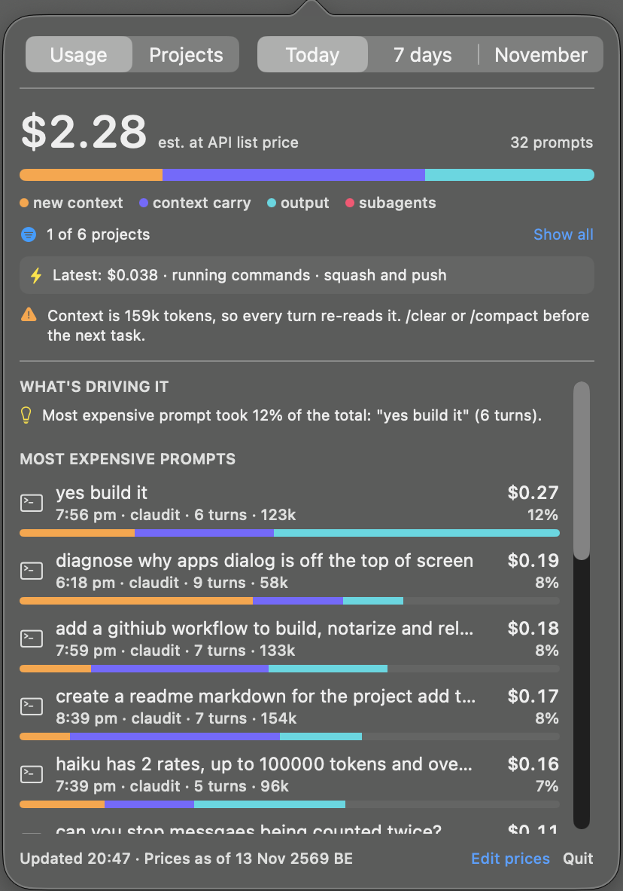

# Claudit

A macOS menu bar app that shows what your [Claude Code](https://claude.com/claude-code) usage would cost, per prompt, project and model. It reads the transcripts Claude Code already writes to `~/.claude/projects`, so there is nothing to configure and nothing leaves your Mac.



## What it does

- **Menu bar total.** Today's estimated cost sits next to the icon. Hover for the full popover, click to pin it open.
- **Usage tab.** Totals for Today, 7 days or the current month, split into cache re-reads ("carry"), new input, output and subagents. Below that:
  - your most expensive prompts, each attributed to what it did (exploring code, implementing, running commands, web research, MCP connectors, subagents or conversation);
  - cost by activity, project and model;
  - short insights, such as a long context that is being re-read on every turn.
- **Projects tab.** Tick the projects to include. The filter applies to the Usage tab and the menu bar total, and is remembered. "only" isolates a single project.
- **Monthly budget.** A bar above the footer, with a tick for each day of the month, tracks this month's spend against a limit you type in (whole dollars) on the right. The plain marker is today's position in the month and the coloured marker is the share of the limit used so far: green while you are at or behind the day marker, red once you are ahead of it. The limit is remembered, follows the project filter, and is greyed out while it is 0.
- **Editable prices.** Right-click the menu bar item and choose *Edit prices…*. Per model you can set input, output, cache read and 5-minute / 1-hour cache write rates, and a second set of rates for prompts over a token threshold (for models such as Haiku 5.5 that charge more for large prompts).
- **Update from Anthropic.** The price editor can read Anthropic's [pricing page](https://platform.claude.com/docs/en/about-claude/pricing), show what differs from your table, and apply only the changes you tick.
- **Command-line report (from source).** A developer tool that is not part of the released app. From a checkout, `swift run claudit-report --days 7 --top 20` prints the cost breakdown for the last 7 days and the 20 most expensive prompts in a terminal. `--days` defaults to 1 and `--top` to 12.

## Read this before trusting the numbers

Claudit **estimates** cost: it multiplies the token counts in your transcripts by pay-as-you-go API list prices. It does not read your bill.

- On the API, the estimate should be close to what you pay, provided the price table is right.
- On a Claude subscription (Pro, Max) you pay a flat fee, so the figure means "what this usage would cost at API rates". It is still a useful way to see which prompts, projects and models use the most.
- A message that was copied into a resumed session is counted once.

## Requirements

- macOS 14 or later on an Apple Silicon Mac (the released builds are arm64 only).
- Claude Code, with transcripts under `~/.claude/projects`.
- To build from source: a Swift 6 toolchain (Xcode 16 or later).

## Build and run

```sh
./build_app.sh          # builds build/Claudit.app (ad-hoc signed)
open build/Claudit.app
```

Optional settings for `build_app.sh`:

| Variable | Effect |
| --- | --- |
| `VERSION=1.2.3` | Set the app version (default `0.1`) |

Run the tests with `swift test`. You can also open `Package.swift` in Xcode.

## Where things are stored

| What | Where |
| --- | --- |
| Price table | `~/Library/Application Support/Claudit/price-table.json` |
| Project filter | the app's user defaults |
| Monthly limit | the app's user defaults |

If the price file can't be read, Claudit falls back to the built-in defaults without overwriting it, so you can repair it by hand.

## Project layout

| Path | Purpose |
| --- | --- |
| `Sources/ClauditCore` | Transcript parsing, pricing and aggregation, with no UI |
| `Sources/Claudit` | The menu bar app (AppKit shell, SwiftUI views) |
| `Sources/ClauditReport` | The `claudit-report` command-line tool (run from source with `swift run`) |
| `Tests/ClauditCoreTests` | Unit tests for the core |

## License

Licensed under the [Apache License, Version 2.0](LICENSE).
